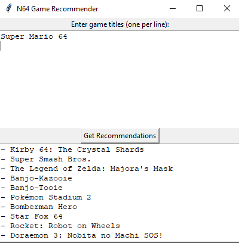
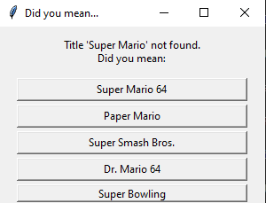
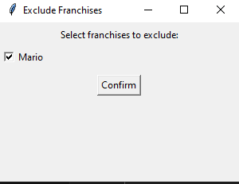

# N64 Game Recommender

## General Info

This project allows users to input Nintendo 64 (N64) games they enjoy and receive recommendations for similar games.

## Features

- Includes a workbook of data for every N64 game
- Basic GUI for user input
- Automatically suggests corrections for mistyped titles
- Allows users to exclude franchises from the recommendations
- Recommends the top 10 games using TF-IDF and cosine similarity

## Usage Instructions

Before running the program, install the required packages:

```bash
pip install -r requirements.txt
```

Then launch the GUI:

```bash
python main.py
```

From there:



- Input one game title per line.
- Click "Get Recommendations" to generate suggestions.
- If a title is mistyped, the GUI will offer correction options.



- You'll also be given the choice to exclude franchises related to your inputted games from the results.




## Limitations

- The data used for the N64 games is incomplete and could be refined.
- Only N64 games are supported

## Scripts

This project includes scraping scripts (in /scripts/) used to gather data from Wikipedia, GiantBomb, and MobyGames.
While the scripts are hardcoded for the N64, they can be adapted to other consoles with minor edits.

**To run the scraping scripts:**

- You'll need your own **GiantBomb API key**.

- Be aware that DuckDuckGo’s search API may trigger **rate limiting**. Unfortunately, I was unable to find a solution to this.

